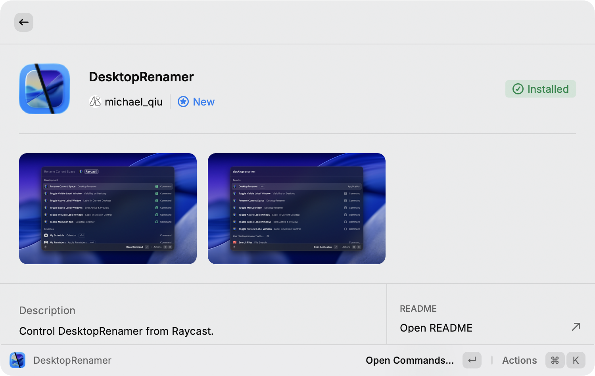

---
hide:
  - navigation
---

# Raycast Integration

The official [DesktopRenamer Raycast extension](https://www.raycast.com/michael_qiu/desktoprenamer) is a reference client for both API surfaces.

<figure class="dr-visual">
  
  <figcaption>The companion extension exposes DesktopRenamer controls through Raycast.</figcaption>
</figure>

## Setup

1. Install DesktopRenamer and the Raycast extension.
2. Enable **SpaceAPI** in **Settings → General → Advanced**.
3. If **Restrict SpaceAPI access** is enabled, add Raycast to **Approved apps** in the same section.
4. Grant DesktopRenamer Accessibility permission in **System Settings → Privacy & Security → Accessibility**.
5. Open the extension and refresh its space and window data.

The extension uses the structured JSON-RPC SpaceAPI over a Unix-domain socket for automatic and SpaceAPI-mode reads and operations. Approve Raycast itself; the extension connects directly from Raycast rather than through an `osascript` child process. For older DesktopRenamer versions that predate socket support, it uses DNC only after confirming the older API version. It never falls back to DNC after an access denial or ambiguous socket failure. When SpaceAPI restriction is off, older clients can continue using DNC. The extension is a reference client, not a required dependency.

## Full-screen windows

Full-screen spaces are managed differently from regular desktops. Some Accessibility operations require the target application to become active first, and DesktopRenamer may temporarily switch spaces or exit full screen before completing a window action. The command may therefore take longer than a regular desktop operation.

After any move, rearrangement, or full-screen transition, wait for the next SpaceAPI update before refreshing the Raycast UI. Do not cache space identifiers indefinitely.

## Diagnosing a missing result

- Confirm that DesktopRenamer’s API is enabled.
- If the extension reports that the app is not approved, add Raycast in **Settings → General → Advanced → Approved apps**. Re-approve local ad-hoc Raycast or DesktopRenamer builds after rebuilding them.
- Confirm Accessibility permission and restart DesktopRenamer after changing it.
- Ensure the client connects to the authenticated socket before sending SpaceAPI requests. DNC-only clients work only when access restriction is off.
- Re-request `GetSpaceList` after displays or full-screen applications change.
- Use `osascript` to test the AppleScript surface independently of Raycast.
